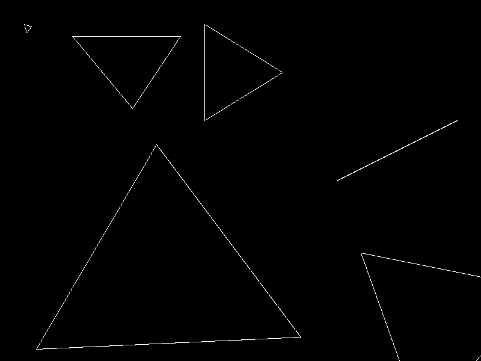
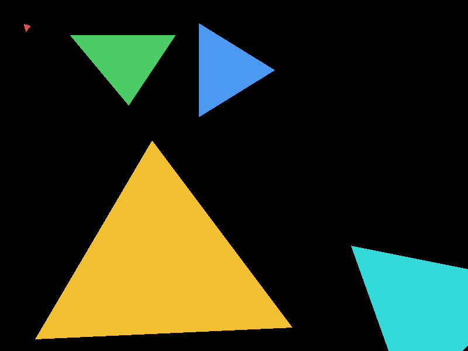
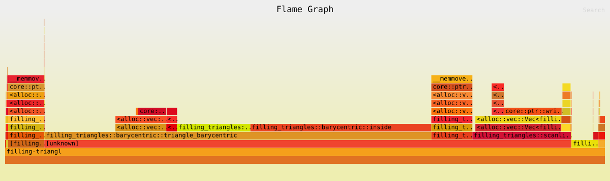

# Lab 5: Filling triangles

La función `triangle` ahora puede dibujar el contorno o rellenar el interior
con dos algoritmos: coordenadas baricéntricas y líneas horizontales.

## Cómo se corre

```bash
cargo run --release                                # ventana: 1, 2 y 3 cambian el modo
cargo run --release -- --compare-triangles         # compara las posiciones de ambos rellenos
cargo run --release -- --benchmark-triangles       # mide la rasterización, sin ventana
cargo run --release -- --export-images             # guarda una imagen de cada modo en docs/
cargo flamegraph -- --benchmark-triangles          # genera flamegraph.svg
```

## Una imagen de cada modo

| `Wireframe` | `FilledBarycentric` | `FilledScanline` |
|---|---|---|
|  |  |  |

Los triángulos son los casos del enunciado: uno pequeño y otro grande, uno
con borde horizontal y otro con borde vertical, los vértices de "grande" en
orden inverso, uno parcialmente fuera del framebuffer y tres vértices sobre
una misma línea. Cada triángulo usa un color uniforme, el mismo en ambos
rellenos.

## Comparación de posiciones

`--compare-triangles` compara las posiciones `(x, y)` generadas por cada
algoritmo, no la imagen:

| Caso | Baricéntrico | Scanline | Solo baric. | Solo scan. | Iguales |
|---|---:|---:|---:|---:|---|
| pequeño | 80 | 80 | 0 | 0 | sí |
| grande | 72 800 | 72 800 | 0 | 0 | sí |
| borde horizontal | 10 900 | 10 900 | 0 | 0 | sí |
| borde vertical | 10 438 | 10 438 | 0 | 0 | sí |
| orden inverso | 72 800 | 72 800 | 0 | 0 | sí |
| parcialmente fuera | 38 970 | 38 970 | 0 | 0 | sí |
| colineales | 0 | 0 | 0 | 0 | sí |

"Orden inverso" genera exactamente las mismas posiciones que "grande".

## Mediciones

`--benchmark-triangles` mide solo `rasterize` sobre los mismos triángulos de
prueba, compilado con `--release`. Cada algoritmo se ejecuta 100 veces por
medición, se repite la medición 15 veces y se toma la mediana. El resultado de
cada ejecución pasa por `std::hint::black_box`.

| Algoritmo | Fragmentos | Mediana por 100 ejecuciones | Por ejecución |
|---|---:|---:|---:|
| Baricéntrico | 205 988 | 112.2 ms | 1.12 ms |
| Scanline | 205 988 | 35.3 ms | 0.35 ms |

Ambos producen el mismo número de fragmentos, y scanline es unas **3 veces más
rápido**.

## Perfil

[`docs/flamegraph.svg`](docs/flamegraph.svg), generado con
`cargo flamegraph -- --benchmark-triangles`:



`triangle_barycentric` y `triangle_scanline` llevan `#[inline(never)]` para
que aparezcan con su nombre en el flamegraph. Reparto de las muestras:

| Dónde | % de muestras |
|---|---:|
| `triangle_barycentric` | 71.8 |
| ↳ cálculos geométricos (`edge_function` e `inside`) | 44.9 |
| ↳ recorrer el rectángulo envolvente | 17.9 |
| ↳ creación de fragmentos (`Vec::push`) | 8.9 |
| `triangle_scanline` | 14.7 |
| ↳ creación de fragmentos (`Vec::push`) | 13.0 |
| ↳ recorrer filas y calcular cortes | 1.7 |
| copiar los fragmentos de cada triángulo al `Vec` de `rasterize` (`extend`) | 12.3 |
| crecimiento del `Vec` (`realloc`) | 0.1 |

## Diferencias encontradas

Los dos rellenos pintan exactamente los mismos pixeles. Los dos chequean cuál
es el centro de cada pixel y usan la misma regla para los pixeles que aparecen
justo sobre un borde, así no se pinta dos veces y tampoco quedan espacios vacíos.

El baricéntrico, a diferencia del scanline, revisa todos los pixeles del
rectángulo que encierra al triángulo y para cada uno calcula si se encuentra
adentro. Muchos de estos pixeles quedan afuera, entonces hace cálculos extras.
Por otra parte, el scanline recorre cada una de las filas, calcula dónde entra
y dónde sale el triángulo en cada fila y sólo pinta lo que está en medio.

Por estas razones el scanline fue unas tres veces más rápido que el
baricéntrico en las mediciones. En el flamegraph podemos ver que el baricéntrico
gasta mucho más tiempo en los cálculos, mientras que el scanline usa la mayor
parte de su tiempo en la creación de fragmentos.

Si los tres puntos se encuentran en una línea, no se pinta nada porque el
triángulo no tiene área. Si los vértices vienen en orden inverso, los dos
algoritmos los reordenan y pintan lo mismo.
